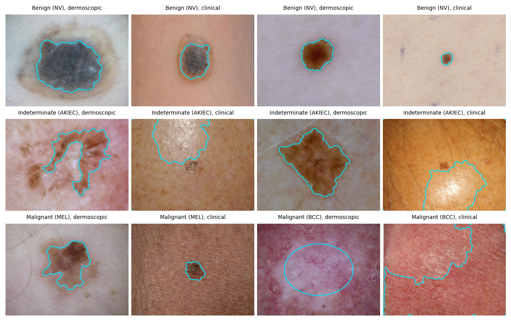
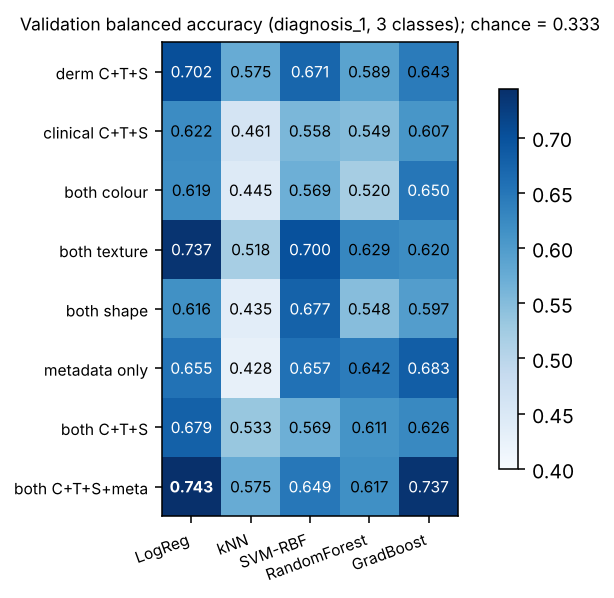
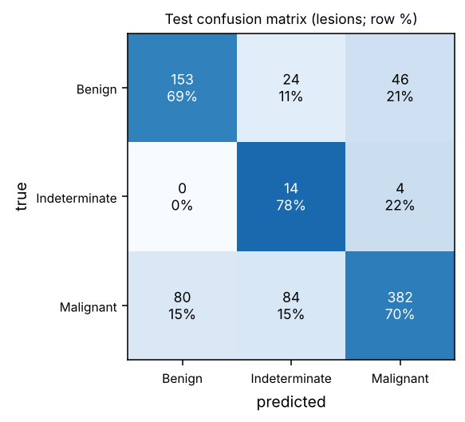
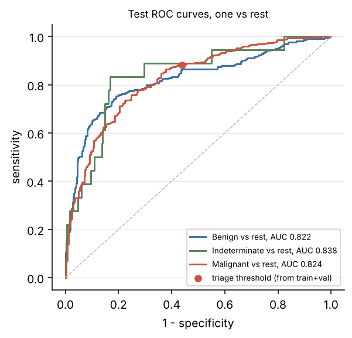
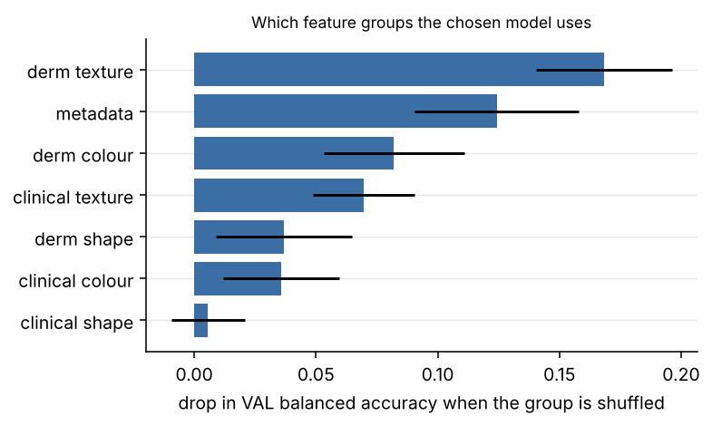

# Classical ML baseline for MILK10k

Bruno Curi · Computer Vision and Speech Recognition, EADA · code: `classical_baseline.py`, `shared/features.py`,
`shared/classical.py` · every number below comes from `python classical_baseline.py` (log in
`outputs/classical_baseline/log.txt`, tables and figures in the same folder).

## 1. Task and evaluation protocol

**Target.** `diagnosis_1` (Benign / Indeterminate / Malignant), one prediction per **lesion**. Each lesion is one row
that holds the features of its dermoscopic image, of its clinical close-up and its metadata, so both views are used
and the unit of evaluation is the lesion, as decided in Milestone 1. **Splits.** The Milestone 1 lesion-level splits,
unchanged: train 3,667, val 786, test 787 lesions (test: 223 Benign, 18 Indeterminate, 546 Malignant).

**Protocol.** (1) Hyper-parameters of every model are tuned by 5-fold stratified CV on the **train** lesions.
(2) Each tuned configuration is scored once on **val**; the configuration with the highest val balanced accuracy is
chosen. (3) It is refitted on train+val and scored **once** on **test**; test was not used for any decision. Missing
age is imputed with the train median and features are standardised inside the pipeline, so nothing is learned from
the rows being scored. **Imbalance:** `class_weight="balanced"` (n / (k · count), the Milestone 1 rule) in every model
that supports it.

**Metrics.** Primary: **balanced accuracy** (mean recall over the 3 classes). Plain accuracy is reported but says little:
a constant "Malignant" answer already scores 69.4% on test. Also macro-F1, macro one-vs-rest ROC-AUC (threshold-free),
per-class recall and precision, and Malignant sensitivity and specificity. Test intervals: stratified bootstrap of the
test lesions, 2,000 resamples (class counts fixed, so the 18 Indeterminate lesions never vanish from a resample).

## 2. Features (concepts from the sessions)

All 10,480 images were decoded at 300x225 (half size, JPEG draft mode) and reduced to **131 numbers per image**
(0 failures, 28 minutes on Colab). A lesion row therefore has 2 x 131 image features plus 7 metadata features = 269.

| group | per image | what it measures | session |
|---|---|---|---|
| Lesion mask | (used by the rest) | Otsu threshold on the smoothed CIELAB lightness L*, the dark component nearest the centre, holes filled; a central ellipse when nothing plausible is found | 4 (thresholding, morphology) |
| Colour (C) | 72 | mean, std, skew of R, G, B, S, V, L*, a*, b*; saturation-weighted hue histogram; S and V histograms; lesion vs skin difference in L*a*b* (ΔE); share of the lesion in each of the 6 dermoscopic colours of the ABCD rule (white, red, light brown, dark brown, blue-grey, black) | 2 (colour spaces, histograms) |
| Texture (T) | 44 | Sobel edge density, local-variance roughness and Laplacian variance on the image and inside the lesion; uniform LBP histograms (8 and 16 neighbours); GLCM contrast, dissimilarity, homogeneity, energy, correlation at distances 1 and 3 | 4 and 5 (filters, edges, texture) |
| Shape (S) | 15 | area, compactness, eccentricity, solidity, extent, axis ratio, convexity, asymmetry about both principal axes, radius variation, border sharpness (the A, B and D of ABCD) | 4 and 5 (regions, shape) |
| Metadata | 7 per lesion | age, sex, body site (missing site = its own "unknown" category); leaky columns (diagnosis_2 to 4, confirm type, biopsy, melanocytic, image_manipulation) never enter | 1 to 3 (data audit) |

**Mask quality (audit).** I inspected the masks of 120 images, 20 lesions per class, both views
(`segmentation_audit.csv`). Overall, 38 masks were good, 17 partial, 59 failed and 6 used the fallback ellipse, so
**54% were unusable**. Failures concentrate where the lesion is not darker than the skin: pink BCCs, actinic
keratoses and SCCs, and clinical close-ups with shadows, ink rings or dark backgrounds. An automatic flag (mask along
more than 5% of the image border, or fallback) agrees with the manual verdicts on 87% of the 120 images (sensitivity
0.94, specificity 0.78). Applied to all images, it flags 16 to 24% of VASC, NV and MEL images against 69 to 78% of BCC,
AKIEC and SCCKA images, and 24% of benign dermoscopic against 75% of malignant clinical images. So **shape and
lesion-colour features describe the lesion mostly for pigmented lesions**; for the rest they partly describe skin.

Lesion masks (cyan). Rows: Benign, Indeterminate, Malignant; two lesions per row, dermoscopic then
clinical. The naevi and the melanoma are traced well; the actinic keratoses and BCCs show the typical failures (skin,
glare, fallback ellipse).

## 3. Feature sets x models, chosen on validation

8 feature sets x 5 models = 40 configurations. Models: logistic regression (C in {0.01, 0.1, 1, 10}), k-NN (k in
{5, 15, 31}, uniform or distance weights; no class weights exist for it), RBF SVM (C in {0.3, 1, 3, 10}), random forest
(300 trees, depth {none, 15}, min leaf {1, 3, 10}) and histogram gradient boosting (learning rate {0.05, 0.1}, leaves
{15, 31}, early stopping). Full table: `comparison.md`.

| feature set (best model) | features | CV bal. acc. (train) | val bal. acc. | val macro-AUC |
|---|---|---|---|---|
| dermoscopic C+T+S (LogReg) | 131 | 0.628 | 0.702 | 0.820 |
| clinical C+T+S (LogReg) | 131 | 0.585 | 0.622 | 0.776 |
| both views, colour only (GradBoost) | 144 | 0.591 | 0.650 | 0.818 |
| both views, texture only (LogReg) | 88 | 0.631 | 0.737 | 0.834 |
| both views, shape only (SVM) | 30 | 0.587 | 0.677 | 0.785 |
| metadata only (GradBoost) | 7 | 0.580 | 0.683 | 0.769 |
| both views C+T+S (LogReg) | 262 | 0.623 | 0.679 | 0.815 |
| **both views C+T+S + metadata (LogReg, C = 0.01)** | **269** | **0.655** | **0.743** | **0.834** |

**What the comparison shows.** (i) **The dermoscopic view carries more signal than the clinical one** (0.702 against
0.622 on val, 0.628 against 0.585 in CV). (ii) **Texture is the strongest image family**; colour and shape alone are
weaker, as expected from the mask audit. (iii) **Metadata alone is almost as good as the images** (0.683 on val): age
and body site separate BCC (median age 65, 30% on head and neck) from naevi (median age 40, 12% on head and neck,
55% with the missing site that Milestone 1 traced to the trunk). Images and metadata are complementary:
adding metadata to the image features raises CV balanced accuracy from 0.623 to 0.655. (iv) **Logistic regression
wins**: mean CV balanced accuracy over the 8 feature sets is 0.612 for LogReg, 0.595 for SVM, 0.582 for gradient
boosting, 0.546 for random forest and 0.472 for k-NN. With 269 correlated features and 87 Indeterminate training
lesions, a strongly regularised linear model (C = 0.01) generalises best. The forests reach good AUCs but their argmax
rarely predicts the minority class (mean val Indeterminate recall 0.35, against 0.74 for LogReg). k-NN has no class weights and suffers in 269 dimensions.

**Choice: both views C+T+S + metadata, logistic regression, C = 0.01.** It has both the best val balanced accuracy
(0.743) and the best CV balanced accuracy (0.655). The runner-up, gradient boosting on the same features (val 0.737,
val AUC 0.872), is within val noise: each of the 18 val Indeterminate lesions moves balanced accuracy by 1.9 pp. Val
scores are above CV scores for 33 of the 40 configurations (median gap 0.05), and picking the best of 40 noisy val
scores is optimistic, which is why the decision on test stays separate.

## 4. Test results (787 lesions, scored once)

| metric | chosen model | 95% CI | always "Malignant" | stratified random |
|---|---|---|---|---|
| **balanced accuracy** | **0.721** | 0.648 to 0.782 | 0.333 | 0.343 |
| macro ROC-AUC | 0.828 | 0.783 to 0.863 | 0.500 | 0.505 |
| macro-F1 | 0.551 | 0.519 to 0.581 | 0.273 | 0.344 |
| accuracy | 0.698 | | 0.694 | 0.558 |
| recall Benign / Indeterminate / Malignant | 0.686 / 0.778 / 0.700 | | 0 / 0 / 1 | 0.291 / 0.056 / 0.683 |
| precision Benign / Indeterminate / Malignant | 0.657 / 0.115 / 0.884 | | | |
| Malignant sensitivity / specificity | 0.700 / 0.793 | 0.659 to 0.736 / 0.739 to 0.838 | 1 / 0 | |

 

**Reading the numbers.** The test balanced accuracy (0.721) sits inside the range val suggested and far above both
trivial baselines, and the three one-vs-rest AUCs are similar (Benign 0.822, Indeterminate 0.838, Malignant 0.824).
**Plain accuracy (0.698) is no better than always answering "Malignant" (0.694)**, the Milestone 1 point about
prevalence made concrete. The errors that matter: **80 of 546 malignant lesions (14.7%) are called benign**, and the
class weight of 14 on Indeterminate makes the model over-call it: 122 lesions are predicted Indeterminate, of which 14
are correct (precision 0.115), including 84 malignant lesions. **Triage operating point:** a P(Malignant) threshold set
on out-of-fold predictions of train+val to reach 90% sensitivity gives, on test, **sensitivity 0.883 and specificity
0.560**; it flags 43% of benign lesions for review. This is the honest price of catching almost nine cancers in ten with
these features.

**Shortcut check (Milestone 1).** On the 49 test lesions with an "altered" image (image_manipulation is not an input),
the model calls only 9 of 26 malignant lesions malignant (recall 0.35, against 0.72 on unaltered lesions), while all 7
altered Indeterminate lesions are right. Edited photos look "not malignant" to the model, and part of the
Indeterminate recall comes from them. Without altered lesions, Indeterminate recall is 7 of 11 and balanced accuracy is
0.677.

**What the model uses** (each group shuffled on val, model fitted on train, drop in balanced accuracy, 10 repeats):
dermoscopic texture 0.168, metadata 0.124, dermoscopic colour 0.082, clinical texture 0.070, dermoscopic shape 0.037,
clinical colour 0.036, clinical shape 0.006. Clinical shape is useless, which matches the mask audit: 75% of malignant
clinical masks are flagged.

## 5. Stretch target: 11 classes

Same features and model family, C re-tuned by CV (C = 0.01). Test: **balanced accuracy 0.420** (chance and majority
class 0.091), accuracy 0.511 (always BCC 0.482), macro-F1 0.329, macro AUC 0.830. Recall is best for SCC/KA (0.68),
naevi (0.65), melanoma (0.54) and BCC (0.52), and lowest for benign keratoses (0.22). BEN_OTH, DF, INF, VASC (7 test
lesions each) and MAL_OTH (1) cannot be evaluated (`stretch_dx.md`).

## 6. Limitations and what the CNN has to beat

(i) **Segmentation**: a lightness threshold suits pigmented lesions and fails on about half of MILK10k, where pink
keratinocyte cancers dominate; since failure depends on the class, shape features partly encode "is this lesion
pigmented" rather than its border. (ii) **Shortcut**: altered photos shift predictions away from Malignant. (iii)
**Small minority class**: 18 val and 18 test Indeterminate lesions make every Indeterminate number noisy (test balanced
accuracy CI ± 0.07). (iv) No patient identifier (Milestone 1), and features at half resolution. **Next steps:** a mask
from colour distance to the surrounding skin, with border-touching masks rejected (one more 30-minute feature run), then
the CNN on the same splits. **Bar for the CNN** (same 787 test lesions): balanced accuracy 0.721, macro AUC 0.828,
Malignant sensitivity 0.70 at specificity 0.79, and sensitivity 0.88 at specificity 0.56 at the triage threshold.
