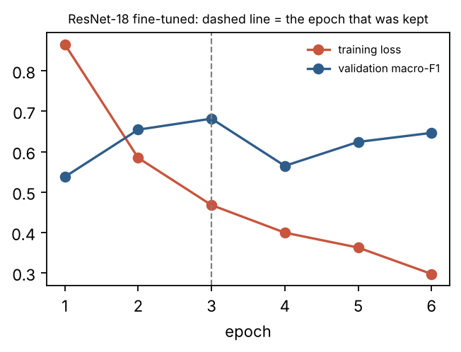
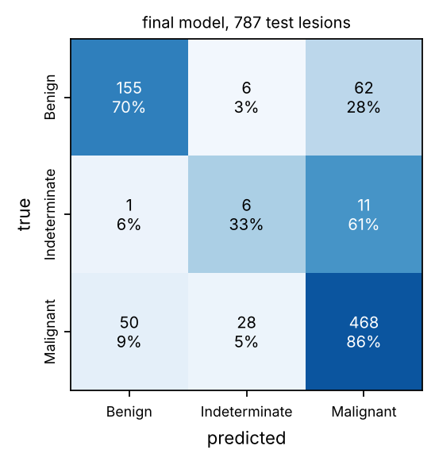
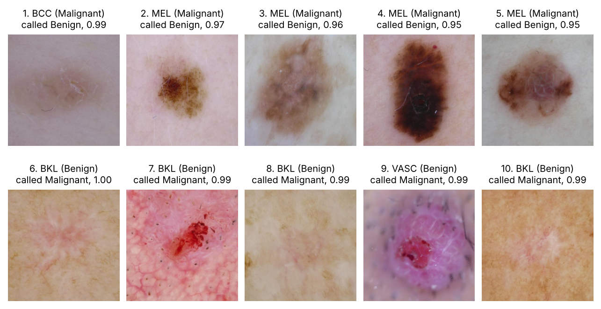
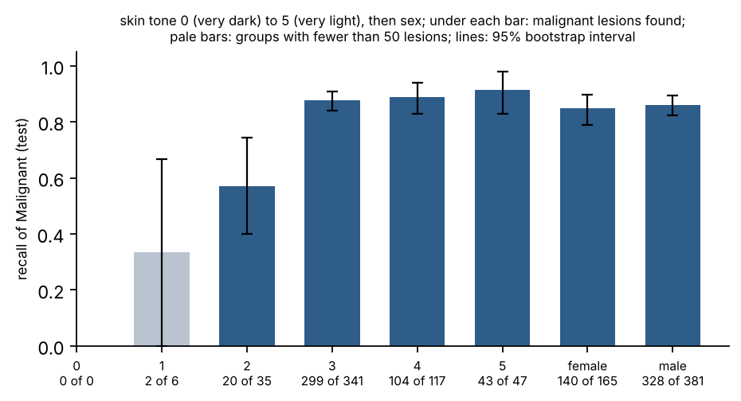

# Final report: skin-lesion classification on MILK10k

Bruno Curi · Computer Vision and Speech Recognition, EADA · course project, Milestones 1 to 5 ·
leaderboard approach name EADA-CV26-BC · every score below is printed by the script named next to it and stored
in <code>outputs/</code>. <b>Draft: the official leaderboard score of section 6 is still to be added.</b>

**Code and results**, repository [github.com/bporto-eada/milk10k-eda](https://github.com/bporto-eada/milk10k-eda)
(how to run everything: [README](https://github.com/bporto-eada/milk10k-eda/blob/main/README.md))

* Data pipeline and split (M1): [milestone1.py](https://github.com/bporto-eada/milk10k-eda/blob/main/m1_data/milestone1.py), [shared/splits.py](https://github.com/bporto-eada/milk10k-eda/blob/main/shared/splits.py), [outputs/splits](https://github.com/bporto-eada/milk10k-eda/tree/main/outputs/splits) · classical baseline (M2): [classical_baseline.py](https://github.com/bporto-eada/milk10k-eda/blob/main/m2_baseline/classical_baseline.py) · CNNs (M3): [session7_cnns.ipynb](https://github.com/bporto-eada/milk10k-eda/blob/main/m3_deep/session7_cnns.ipynb)
* Best model and analysis (M4): [compare_models.py](https://github.com/bporto-eada/milk10k-eda/blob/main/m4_best_model/compare_models.py), [error_analysis.py](https://github.com/bporto-eada/milk10k-eda/blob/main/m4_best_model/error_analysis.py), [fairness.py](https://github.com/bporto-eada/milk10k-eda/blob/main/m4_best_model/fairness.py), results in [outputs/m4_best_model](https://github.com/bporto-eada/milk10k-eda/tree/main/outputs/m4_best_model) ([scoreboard](https://github.com/bporto-eada/milk10k-eda/blob/main/outputs/m4_best_model/scoreboard.md), [error analysis](https://github.com/bporto-eada/milk10k-eda/blob/main/outputs/m4_best_model/error_analysis.md), [fairness](https://github.com/bporto-eada/milk10k-eda/blob/main/outputs/m4_best_model/fairness.md)), weights [model_m4.pt](https://github.com/bporto-eada/milk10k-eda/blob/main/m4_best_model/model_m4.pt)
* Final pipeline (M5): [predict.py](https://github.com/bporto-eada/milk10k-eda/blob/main/m5_final/predict.py), [train_11class.py](https://github.com/bporto-eada/milk10k-eda/blob/main/m5_final/train_11class.py), [make_submission.py](https://github.com/bporto-eada/milk10k-eda/blob/main/m5_final/make_submission.py), [submission.csv](https://github.com/bporto-eada/milk10k-eda/blob/main/m5_final/submission.csv), [leaderboard.png](https://github.com/bporto-eada/milk10k-eda/blob/main/m5_final/leaderboard.png), results in [outputs/m5_final](https://github.com/bporto-eada/milk10k-eda/tree/main/outputs/m5_final)
* [model_card.md](https://github.com/bporto-eada/milk10k-eda/blob/main/model_card.md) · shared code: [shared/deep.py](https://github.com/bporto-eada/milk10k-eda/blob/main/shared/deep.py) · [tests](https://github.com/bporto-eada/milk10k-eda/tree/main/tests)

**In one paragraph.** Eleven models were scored on the same 786 validation and 787 test lesions. The best one by
validation is an ImageNet ResNet-18 fine-tuned as a whole network: macro-F1 **0.682 on validation and 0.597 on test**
(95% CI 0.549 to 0.645, 3 classes). A ViT-B/16, compared the fair way (both frozen, the same new last layer), ties
with the ResNet-18 on validation (0.574 against 0.567) and is ahead on test (0.592 against 0.537). The final model's
errors have one thing in common: it treats brown, sharply bounded lesions as benign and pink ones as malignant, so it
calls 33 of 68 melanomas "not malignant". That failure is worse on darker skin, where it finds 22 of 41 malignant
lesions (54%) against 88% on lighter skin. A check shows that the class weights of the loss overshoot. With 11 outputs
the same network scores 0.420 on validation and 0.432 on our own test split under the leaderboard's rule; the official
score is pending (file ready to upload).

## 1. Problem and data

**The clinical question.** A lesion has worried a patient or a doctor enough to be photographed through a
dermatoscope. Is it benign, malignant, or indeterminate? Such a prediction would serve as a second reader for triage, at the
moment the image is taken, and never as a diagnosis. The costly error is a malignant lesion called benign.

**MILK10k** (MILK study team, ISIC Archive, CC BY-NC): 5,240 lesions, each with one dermoscopic image and one clinical
close-up (10,480 JPEGs of 600x450), with age, sex, body site and two label sets: `diagnosis_1` with 3 classes and the
11 classes of `training_gt.csv`. Our networks read the dermoscopic image only, as the brief allows; the classical models
of M2 also used the clinical image and the metadata.

| diagnosis_1 | lesions | share | made of (11 classes, lesions) |
|---|---|---|---|
| Malignant | 3,634 | 69.4% | BCC 2,522 · SCCKA 473 · MEL 450 · AKIEC 180 (in situ) · MAL_OTH 9 |
| Benign | 1,483 | 28.3% | NV 746 · BKL 544 · DF 52 · INF 50 · VASC 47 · BEN_OTH 44 |
| Indeterminate | 123 | 2.3% | AKIEC 123 (actinic keratoses) |

**Class imbalance.** On the train split the ratio is 29 : 1 for 3 classes (Malignant against Indeterminate) and
353 : 1 for 11 classes (BCC 1,765 lesions against MAL_OTH 5). The data are not what a clinic sees: 95.7% of the lesions
were confirmed by histopathology, so they are the lesions someone decided to biopsy, which is why 69% are malignant and
48% are BCC. Three consequences run through the project. The metric is **macro-F1 per lesion**, in which a rare class
counts as much as a common one: always answering "Malignant" has 69% accuracy and a macro-F1 of 0.273. The loss uses
class weights computed on the train split. And no accuracy measured here is the accuracy the model would have in a clinic.

## 2. Splits

| split | lesions | images | Benign / Indeterminate / Malignant | used for |
|---|---|---|---|---|
| train | 3,667 | 7,334 | 1,038 / 87 / 2,542 | fitting the weights, class weights, feature scaling |
| validation | 786 | 1,572 | 222 / 18 / 546 | every choice: hyper-parameters, epoch, model |
| test | 787 | 1,574 | 223 / 18 / 546 | one score per model, after its choices are fixed |

Lesions are split first and images follow their lesion (`shared/splits.py`): StratifiedGroupKFold with groups =
`lesion_id`, stratified on the 11-class label refined by `diagnosis_1`, 20 folds of 5% (14 to train, 3 to validation,
3 to test), seed 42, created once on 2026-10-05 and reused by every model since.

**Why there is no leakage.** (1) The two images of a lesion show the same lesion, so a split by image would let a
model recognise test lesions. Here 0 lesion ids are shared between any two splits and every lesion has both images in
the same split (asserted in `m1_data/milestone1.py` and in `tests/test_splits.py`). (2) Everything that is fitted is fitted on
train only: network weights, class weights, the scaling and imputation of the classical models. (3) Every choice is
made on validation. (4) Each model's test score is computed once, after the choice; the error analysis and the
fairness check read the saved test predictions and change nothing afterwards. (5) The 479 blind lesions of the
leaderboard have no labels and are only predicted. **What remains:** MILK10k has no patient identifier, so two lesions of
one patient can sit in train and test, and validation has been used for many choices since Milestone 2, so validation
scores are optimistic. The test column measures by how much.

## 3. Models and scoreboard

Target of the whole analysis: **`diagnosis_1`, 3 classes** (Path A of the brief). Same 786 validation and 787 test
lesions and the same metric for every row.

| | model | input | trained weights | val macro-F1 | test macro-F1 | test 95% CI |
|---|---|---|---|---|---|---|
| M3 | **ResNet-18 fine-tuned, whole network (best → final)** | derm image 224x224 | 11,178,051 | **0.682** | **0.597** | 0.549&nbsp;to&nbsp;0.645 |
| M3 | ResNet-18 fine-tuned, layer4 | derm image 224x224 | 8,395,267 | 0.681 | 0.634 | 0.584&nbsp;to&nbsp;0.682 |
| M3 | ResNet-18 fine-tuned, layer3 + layer4 | derm image 224x224 | 10,494,979 | 0.676 | 0.627 | 0.570&nbsp;to&nbsp;0.683 |
| M2 | Gradient boosting | both images + metadata, 269 features | n/a | 0.667 | 0.599 | 0.544&nbsp;to&nbsp;0.653 |
| M2 | Random forest | derm image, 131 features | n/a | 0.621 | 0.574 | 0.504&nbsp;to&nbsp;0.643 |
| M3 | MLP on handcrafted features | derm image, 131 features | 8,643 | 0.611 | 0.561 | 0.514&nbsp;to&nbsp;0.608 |
| M4 | ViT-B/16 frozen + linear head | derm image 224x224 | 2,307 | 0.574 | 0.592 | 0.556&nbsp;to&nbsp;0.629 |
| M2 | Logistic regression | both images + metadata, 269 features | n/a | 0.572 | 0.532 | 0.499&nbsp;to&nbsp;0.562 |
| M3 | ResNet-18 frozen + linear head | derm image 224x224 | 1,539 | 0.567 | 0.537 | 0.507&nbsp;to&nbsp;0.568 |
| M3 | CNN from scratch | derm image 224x224 | 306,147 | 0.531 | 0.488 | 0.457&nbsp;to&nbsp;0.524 |
| M3 | MLP on raw pixels | derm image, 32x32 pixels | 196,867 | 0.521 | 0.502 | 0.454&nbsp;to&nbsp;0.560 |
| ref | always Malignant | none | 0 | 0.273 | 0.273 |  |

Sorted by validation macro-F1. M2 = classical models on handcrafted colour, texture and shape features
(Sessions 4 and 5). M3 = neural networks of Sessions 6 and 7, rows as reported then. M4 = this milestone
(<code>compare_models.py</code>, <code>outputs/m4_best_model/scoreboard.md</code>). Networks with ImageNet weights from
torchvision (IMAGENET1K_V1), cross-entropy with the train class weights, Adam, random flips, the best validation epoch
kept. Test interval: 2,000 bootstrap resamples of the test lesions.

Three things stand out. The three fine-tuned ResNet-18 take the top places, and the classical model needs both images
and the metadata to come close. Every model except the frozen ViT scores lower on test than on validation, by 0.02 to
0.085: validation was used to choose, so it is optimistic. And the test intervals of the first seven rows all overlap:
this split cannot rank them.

**Class imbalance: do the class weights help?** Every network above was trained with the class weights of Milestone 1
in its loss (Benign 1.18, Indeterminate 14.05, Malignant 0.48), so the comparison between them is fair. To see what
the weights do, the same linear layer was trained twice on the frozen ResNet-18 features, with and without them, and
scored on validation (`class_weights_check.py`):

| loss | val macro-F1 | recall Benign | recall Indeterminate | recall Malignant | lesions called Indeterminate (18 are) | of which right |
|---|---|---|---|---|---|---|
| with class weights | 0.567 | 0.662 | 0.889 | 0.722 | 102 | 16 |
| without class weights | 0.703 | 0.536 | 0.500 | 0.907 | 10 | 9 |

The weights do what they are meant to do: the recall of the rare class goes from 9 to 16 of 18 lesions. But they
overshoot. The head then calls 102 lesions Indeterminate, the precision of that class collapses, and macro-F1 falls
from 0.703 to 0.567.

| frozen backbone + linear head | loss | mean of 5 seeds | lowest | highest |
|---|---|---|---|---|
| ResNet-18 | with class weights | 0.573 | 0.534 | 0.604 |
| ResNet-18 | without class weights | 0.676 | 0.650 | 0.703 |
| ViT-B/16 | with class weights | 0.604 | 0.574 | 0.618 |
| ViT-B/16 | without class weights | 0.688 | 0.656 | 0.700 |

**One run is one sample**, so the same head was trained with five seeds on both frozen backbones (validation
macro-F1, `class_weights_check_seeds.csv`). The effect of the weights is not a lucky seed: every run without them
(0.650 or more) beats every run with them (0.618 or less). And for this head the seed alone moves the score by up
to 0.07, more than the gap between any two neighbouring rows of the scoreboard.

So the weights did not help our metric. The final model keeps them, because it was chosen among networks that all
share that loss; choosing again would mean retraining every network without the weights, not picking the one variant
tried here. It is the first thing to change next (section 7), and the same over-calling of Indeterminate shows up in
the final model's errors (section 5).

## 4. Best model

**Rule, fixed before any test score was computed:** the deep model with the highest validation macro-F1 is the final
model, and its test score is reported once.

**Step 1, the fair comparison of Session 9: both backbones frozen, the same new last layer, the same training.** Each
pretrained network loses its head (`nn.Identity()`), so it returns its features: 512 numbers per image for ResNet-18,
768 for ViT-B/16. They are computed once and saved, and the same linear layer is trained on each (25 epochs, Adam,
learning rate 1e-3, class weights). Only the backbone changes.

| frozen backbone + the same linear head | weights of the backbone | val macro-F1 | test macro-F1 |
|---|---|---|---|
| ResNet-18 | 11.7 million | 0.567 | 0.537 |
| ViT-B/16 | 86.6 million | 0.574 | 0.592 |

With the seed of the project the two are tied on validation (0.007 apart), and the ViT is ahead by 0.055 on test. Over
the five seeds of section 3 the ViT averages 0.604 on validation and the ResNet-18 0.573, with overlapping ranges. So
the ImageNet features of a ViT are at least as useful for dermoscopy as those of a ResNet-18, at seven times the size,
and its lead is no larger than the spread between seeds.

**Step 2, the final model.** Session 7 showed that the ResNet-18 gains most when it is allowed to adapt: 0.567 frozen,
0.682 with the whole network fine-tuned. The frozen ViT (0.574) is far below that on validation, so the rule gives the
fine-tuned ResNet-18.

**What this does not show.** It does not show that a CNN beats a ViT. The ViT was only tried frozen, because
retraining 86.6 million weights on a 2-core CPU takes hours; fine-tuned, it could win. And on test the frozen ViT
(0.592) and the final model (0.597) are equal within their intervals. Choosing between them on those two numbers
would be choosing on the test set, so validation decides.

**Decision: ResNet-18, whole network fine-tuned. Its number: test macro-F1 0.597 (95% CI 0.549 to 0.645)**, test
accuracy 0.799. Recipe: ImageNet weights, a new last layer `nn.Linear(512, 3)`, every layer trained, Adam, learning
rate 1e-4, batches of 64, random flips, 6 epochs. The validation score of 0.682 was 0.085 too optimistic: it is the
best of six noisy epochs, picked on 786 lesions of which 18 are Indeterminate.

Session 7 had not saved the weights, so the M4 script trained the model again with the same seed. It gives the same
score after every epoch and the same answer for each of the 786 validation and 787 test lesions. Weights:
`m4_best_model/model_m4.pt`; test predictions: `outputs/m4_best_model/predictions_test.csv`.

Training loss and validation macro-F1 after each epoch (<code>history_resnet18.csv</code>). The loss
falls at every epoch, from 0.865 to 0.298. Validation rises to 0.682 at the third epoch and drops to 0.565 at the
fourth: the network fits the training lesions better and better, and the validation lesions worse. That is
overfitting. Early stopping keeps the weights of the third epoch.

## 5. Error analysis and fairness

All of this section is the final model on the 787 test lesions (`error_analysis.py`, `fairness.py`).

| class | lesions | precision | recall | F1 |
|---|---|---|---|---|
| Benign | 223 | 0.752 | 0.695 | 0.723 |
| Indeterminate | 18 | 0.150 | 0.333 | 0.207 |
| Malignant | 546 | 0.865 | 0.857 | 0.861 |

158 lesions are misclassified (20.1%). The two large confusions are Benign called Malignant (62) and Malignant called
Benign (50). Indeterminate is predicted 40 times and is right 6 times: its F1 of 0.207 is what pulls the macro-F1 down
to 0.597, and it rests on 18 lesions.

| diagnosis | lesions | wrong | answers given |
|---|---|---|---|
| BKL (benign) | 83 | 44 (53%) | 39 Benign, 40 Malignant, 4 Indeterminate |
| **MEL (malignant)** | 68 | **33 (49%)** | **25 Benign**, 35 Malignant, 8 Indeterminate |
| AKIEC (malignant or indeterminate) | 45 | 19 (42%) | 5 Benign, 31 Malignant, 9 Indeterminate |
| SCCKA (malignant) | 71 | 9 (13%) | 2 Benign, 62 Malignant, 7 Indeterminate |
| NV (benign) | 112 | 12 (11%) | 100 Benign, 12 Malignant |
| BCC (malignant) | 379 | 29 (8%) | 19 Benign, 350 Malignant, 10 Indeterminate |

**Which classes are confused.** Benign keratoses (BKL) are the benign lesions most often called Malignant (40 of 83),
and melanomas are the malignant lesions most often called Benign (25 of 68). Nevi and BCC, the two largest classes,
are mostly right (11% and 8% wrong).

**The misclassified images:** the five most confident mistakes in each direction, as the network saw them.

**What they have in common.** Images 2 to 5 are melanomas called Benign with 95 to 97% confidence: all four are
brown, pigmented patches on pale skin, the look of a mole. Image 1 is a BCC so faint that almost nothing is visible.
Images 6 to 10 are benign lesions called Malignant with 99% confidence or more: none has brown pigment. Three are pale
pink areas without an outline (6, 8, 10) and two are red with a bloody centre (7, 9). The numbers say the same for the
whole test set (`error_analysis.md`):

| | lesions | wrong | | lesions | wrong |
|---|---|---|---|---|---|
| Benign, less pigmented half | 70 | 55.7% | Malignant, more pigmented half | 230 | 22.2% |
| Benign, more pigmented half | 153 | 19.0% | Malignant, less pigmented half | 316 | 8.5% |
| Benign, Otsu mask failed | 50 | 70.0% | Malignant, Otsu mask plausible | 243 | 21.4% |
| Benign, Otsu mask plausible | 173 | 19.1% | Malignant, Otsu mask failed | 303 | 8.6% |

Pigmentation: the MONET "pigmented" score published with MILK10k, split at its median. Otsu mask: the
lesion mask of Sessions 5 and 8; it fails when there is no dark, sharply bounded lesion to outline.

The network learned the association that dominates the data: brown with a clear outline means benign (a nevus), pink
without one means malignant (BCC is 48% of all lesions). A lesion that breaks the association is where it fails: a
benign lesion with little pigment is misclassified in more than half of the cases, and a pigmented malignant lesion is
missed more than twice as often as a pale one. Melanoma pays for it: **the model finds 35 of 68 melanomas** and 350 of
379 BCCs. The overall Malignant recall of 0.857 hides this, because BCC is seven tenths of the malignant test lesions.
Mistakes are less confident on average (0.72 against 0.85), but 18 of them come with a confidence of 0.95 or more, so
a confidence threshold would not catch the worst ones.

**Fairness.** Skin tone is MILK10k's `skin_tone_class`, from 0 (very dark) to 5 (very light). One row per group
(`fairness.py`, `fairness.md`):

| group | lesions (B / I / M) | macro-F1 | Malignant found (recall, 95% interval) | Benign found (recall) | Indeterminate: called, right |
|---|---|---|---|---|---|
| all&nbsp;test&nbsp;lesions | 787&nbsp;(223/18/546) | 0.597 | 468 of 546 (0.857) | 155 of 223 (0.695) | 40, 6 |
| skin&nbsp;tone&nbsp;0,&nbsp;very&nbsp;dark | 1&nbsp;(1/0/0) | too&nbsp;few | none in the group | 0 of 1 | 1, 0 |
| skin&nbsp;tone&nbsp;1 | 9&nbsp;(2/1/6) | too&nbsp;few | 2 of 6 | 2 of 2 | 3, 1 |
| skin&nbsp;tone&nbsp;2 | 72&nbsp;(37/0/35) | 0.439&nbsp;* | 20 of 35 (0.571, 0.400&nbsp;to&nbsp;0.743) | 27 of 37 (0.730) | 2, 0 |
| skin&nbsp;tone&nbsp;3 | 466&nbsp;(111/14/341) | 0.589 | 299 of 341 (0.877, 0.842&nbsp;to&nbsp;0.909) | 66 of 111 (0.595) | 27, 5 |
| skin&nbsp;tone&nbsp;4 | 170&nbsp;(50/3/117) | 0.575 | 104 of 117 (0.889, 0.829&nbsp;to&nbsp;0.940) | 41 of 50 (0.820) | 6, 0 |
| skin&nbsp;tone&nbsp;5,&nbsp;very&nbsp;light | 69&nbsp;(22/0/47) | 0.596&nbsp;* | 43 of 47 (0.915, 0.830&nbsp;to&nbsp;0.979) | 19 of 22 (0.864) | 1, 0 |
| darker,&nbsp;0&nbsp;to&nbsp;2 | 82&nbsp;(40/1/41) | 0.526 | **22 of 41 (0.537**, 0.390&nbsp;to&nbsp;0.683) | 29 of 40 (0.725) | 6, 1 |
| lighter,&nbsp;3&nbsp;to&nbsp;5 | 705&nbsp;(183/17/505) | 0.602 | **446 of 505 (0.883**, 0.855&nbsp;to&nbsp;0.911) | 126 of 183 (0.689) | 34, 5 |
| female | 269&nbsp;(99/5/165) | 0.538 | 140 of 165 (0.848, 0.788&nbsp;to&nbsp;0.897) | 75 of 99 (0.758) | 6, 0 |
| male | 518&nbsp;(124/13/381) | 0.602 | 328 of 381 (0.861, 0.824&nbsp;to&nbsp;0.895) | 80 of 124 (0.645) | 34, 6 |

* no Indeterminate lesion in the group. Groups under 50 lesions are not interpreted. Interval: 2,000
bootstrap resamples of the group's malignant lesions.

*How to read it.* The macro-F1 that the brief asks for is in the table, but it cannot be compared between groups. It
averages the classes that occur in a group, and Indeterminate occurs very unevenly: 14 of its 18 test lesions have
skin tone 3, and tones 2 and 5 have none. In tone 5 the model finds 43 of 47 malignant and 19 of 22 benign lesions,
the best of all groups, yet its macro-F1 is 0.596, because one lesion was called Indeterminate and that class then
scores 0. The gap between women (0.538) and men (0.602) is the same effect: none of the 5 Indeterminate lesions of
women is found, 6 of the 13 of men are. What can be compared is the recall of Malignant and of Benign.

*Sex: no difference found.* The recall of Malignant is 0.848 for women and 0.861 for men. The recall of Benign is
higher for women (0.758 against 0.645), but with about 100 benign lesions per group the two intervals overlap (0.667
to 0.838 and 0.565 to 0.726).

*Skin tone: the model is worse on darker skin.* On tones 0 to 2 it finds 22 of 41 malignant lesions (0.537), on tones
3 to 5 it finds 446 of 505 (0.883), and the two intervals are far apart. The recall of Benign is similar (0.725 and
0.689). Two things explain the gap (`fairness_malignant_by_diagnosis.csv`). The mix of diagnoses: 20 of the 41
malignant lesions on darker skin are melanomas (49%) against 48 of 505 on lighter skin (9.5%), and melanoma is the
diagnosis the model misses most. And inside the same diagnosis the model also finds less on darker skin: 12 of 18 BCCs
against 338 of 361, and 8 of 20 melanomas against 27 of 48. Both fit the pigmentation shortcut of the error analysis,
which was not tested further here. **Limits of this check:** only 82 test lesions have tones 0 to 2, and ten have
tones 0 or 1, about which nothing can be said. The direction is clear and the size is not.

## 6. Leaderboard

**The 11-class model (Path A).** The analysis above used 3 classes; the leaderboard always scores 11. So the best
architecture of section 4 was trained once more with 11 outputs (`train_11class.py`): same split, same recipe, same
ImageNet starting weights. Two things change: the labels (the 11 classes of `training_gt.csv`, in its column order,
which is the order of the submission file) and the last layer, `nn.Linear(512, 11)`. One adjustment: MAL_OTH has 5
training lesions and would get a loss weight of 66.7, so it gets the weight of the next rarest class (10.75).

**The leaderboard's rule.** The leaderboard does not take the most likely class. It turns each of the 11
probabilities of a lesion into yes or no at 0.5, computes the F1 of each class and averages the 11. The 11
probabilities of a lesion add up to 1, so at most one of them can reach 0.5, and a lesion whose largest probability
is 0.45 gets "no" eleven times: it counts as a miss for its true class. The course's line gives the same score
locally: `f1_score(Y, P >= 0.5, average="macro", zero_division=0)`.

| | lesions | macro-F1, most likely class | macro-F1, cut at 0.5 (the leaderboard's rule) | lesions with no probability ≥ 0.5 |
|---|---|---|---|---|
| validation (the epoch was chosen on it) | 786 | 0.413 | **0.420** | 25.7% |
| our own test split, opened once for this model | 787 | 0.419 | **0.432** (95% interval 0.365 to 0.484) | 27.3% |
| **official leaderboard, approach EADA-CV26-BC** | 479 | | **pending upload** | 29.4% |

One validation lesion in four gets no diagnosis this way. The score still does not fall below the usual one, because
the answers that disappear are the unsure ones: for those lesions the most likely class is right only 46% of the
time (`predictions_val_11class.csv`).

| class | train lesions | validation: lesions, said yes, F1 | our test: lesions, said yes, F1 |
|---|---|---|---|
| BCC | 1,765 | 378, 237, 0.693 | 379, 213, 0.652 |
| NV | 521 | 113, 79, 0.635 | 112, 84, 0.714 |
| BKL | 380 | 81, 51, 0.379 | 83, 45, 0.328 |
| SCCKA | 332 | 70, 72, 0.493 | 71, 82, 0.588 |
| MEL | 314 | 68, 65, 0.511 | 68, 73, 0.525 |
| AKIEC | 213 | 45, 37, 0.390 | 45, 44, 0.427 |
| DF | 37 | 8, 9, 0.235 | 7, 3, 0.400 |
| INF | 35 | 8, 17, 0.240 | 7, 9, 0.250 |
| VASC | 34 | 6, 7, 0.923 | 7, 9, 0.750 |
| BEN_OTH | 31 | 6, 10, 0.125 | 7, 10, 0.118 |
| MAL_OTH | 5 | 3, 0, 0.000 | 1, 0, 0.000 |

**Which classes score 0, and why.** Only MAL_OTH. The model never gives it 0.5: it has 5 training lesions, and 3
and 1 in our two splits. A class that is never predicted has no precision, and `zero_division=0` counts its F1 as 0.
BEN_OTH, DF and INF are next (0.12 to 0.40): each rests on 6 to 8 lesions.

**BCC shows the price of the class weights.** 378 validation lesions are BCC, but only 237 get a BCC probability of
0.5 or more. BCC has the smallest loss weight (0.19), so the network is trained to hold back on it. This is the
overshoot of section 3 again.

**Per-class thresholds** (the optional step of the brief) were not used. They would be tuned on validation, where
five classes have 3 to 8 lesions, and the file would no longer hold probabilities. `submission.csv` is the plain
softmax output of the model.

**Our estimate against the official score.** The fairest local estimate is the test split: **0.432**. Validation
(0.420) chose the epoch. What we expect before uploading, and why the official score can differ:

1. **Small classes.** Five classes rest on 1 to 8 lesions in each of our splits. One lesion more or less moves such a
   class by 0.1 or more, and the macro-F1 by 0.01 or more. Our interval, 0.365 to 0.484, is that noise for 787 lesions;
   the leaderboard has 479.
2. **MAL_OTH is a step of 0.09.** The model never says MAL_OTH. If the 479 blind lesions hold one, the class scores 0,
   as on our split. If they hold none, the scoring code that ISIC publishes gives a class without lesions and without
   "yes" a score of 1, where `zero_division=0` gives 0. One eleventh of the macro-F1 hangs on that.
3. **The blind lesions do not look like ours to the model.** Without any label, its answers already differ
   (`submission.csv`): it says BCC for 15.7% of the blind lesions against 27.1% on our test split, and SCCKA for 20.5%
   against 10.4%; 29.4% get no diagnosis against 27.3%. A different mix of diagnoses moves a macro-F1.
4. **What is not a reason.** The test images were never used to train or tune anything, and the optimism of
   validation only affects the 0.420, not the 0.432.

**Official result and the gap: to be written after the upload** (score, rank and screenshot `m5_final/leaderboard.png`).

*Limits of this model.* Its best epoch is the last of the 6, so it is probably under-trained; the recipe was kept so
that only the labels and the last layer changed. One run, one seed. `submission.csv` names its first column `lesion`,
as the brief and the challenge page ask; the scoring code that ISIC publishes reads `lesion_id`, so the same values
are also saved as `submission_lesion_id.csv`, to upload only if the first file is refused.

## 7. Model card and limits

The full card is [model_card.md](https://github.com/bporto-eada/milk10k-eda/blob/main/model_card.md). In short:

* **Intended use.** Teaching and research on MILK10k: a worked example of an honestly evaluated pipeline, and a
  baseline for the leaderboard. `python m5_final/predict.py image.jpg` returns the probabilities for one dermoscopic image.
* **Not to be used for** diagnosis, triage, or any decision about a patient; for clinical photographs or phone
  pictures (it has only seen dermoscopic images from one study); for commercial purposes (the data are CC BY-NC).
* **Why not, in numbers.** It misses 14% of the malignant test lesions and 49% of the melanomas; on darker skin it
  misses 46% of the malignant lesions; its Indeterminate answers are right 15% of the time; 18 of its wrong answers
  come with a confidence of 0.95 or more.
* **What the numbers do not cover.** The lesions were selected by biopsy (69% malignant), so no score here is a
  clinic's score. One study. No patient identifier, so lesions of one patient may be on both sides of the split. Skin
  tones 0 and 1: ten test lesions. MAL_OTH: 9 lesions in total, not evaluable. One training run per model, one seed:
  the intervals measure the sampling noise of the test lesions, not the noise between runs.
* **What to change first.** The class weights: on the check of section 3 they cost macro-F1, so every network should
  be retrained with milder weights or none and the choice made again on validation. Then the clinical close-up and the
  metadata as inputs (in the classical baseline, both images with metadata scored 0.743 against 0.702 for the
  dermoscopic image alone, validation balanced accuracy), a fine-tuned ViT on a GPU, and more lesions on darker skin.

Data: MILK study team. MILK10k Benchmark. ISIC Archive, 2025. doi:10.34970/262082 (training data downloaded
from doi:10.34970/648456). Tschandl P, et al. MILK10k: A Hierarchical Multimodal Imaging-Learning Toolkit for
Diagnosing Pigmented and Nonpigmented Skin Cancer and its Simulators. J Invest Dermatol. 2026;146(2):357-364.e7.
doi:10.1016/j.jid.2025.06.1594. Licence CC BY-NC. Models: He K, et al. Deep Residual Learning for Image Recognition,
CVPR 2016; Dosovitskiy A, et al. An Image is Worth 16x16 Words, ICLR 2021; ImageNet-1k weights from torchvision
(IMAGENET1K_V1). Leaderboard scoring code: github.com/ImageMarkup/isic-challenge-scoring. Libraries: PyTorch,
torchvision, scikit-learn, pandas, NumPy, SciPy, Pillow, matplotlib.

