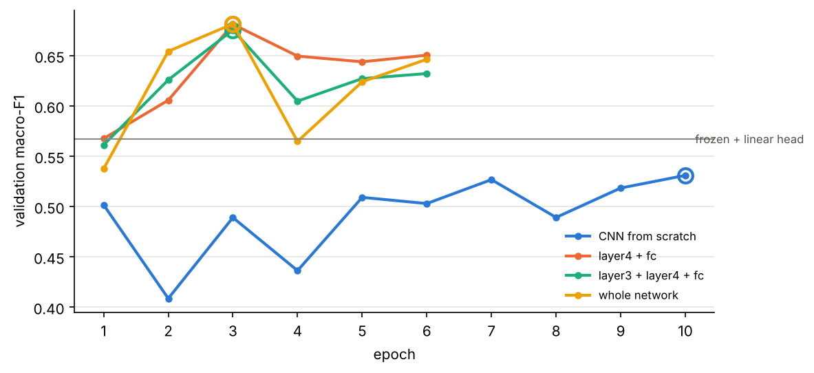
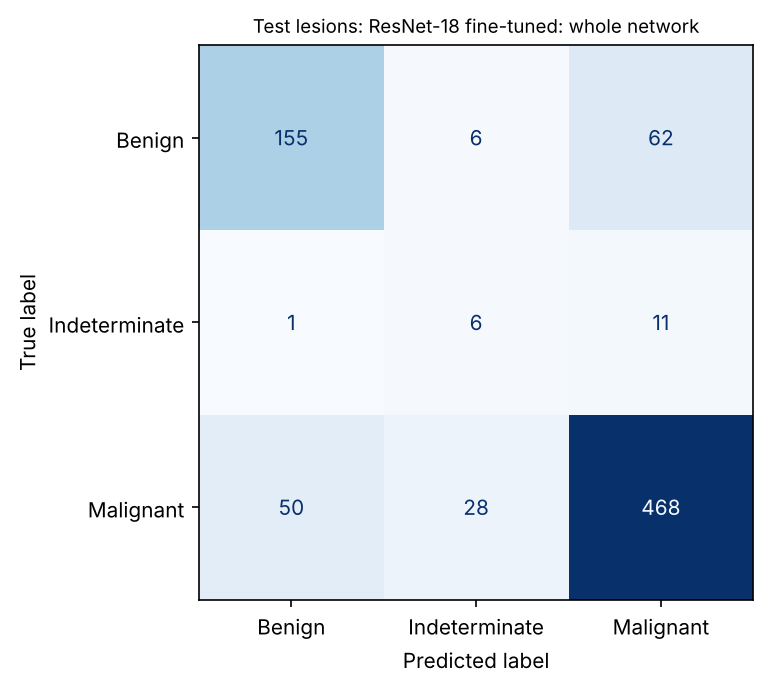

# Session 7 homework: CNNs on MILK10k and the final scoreboard

Bruno Curi · Computer Vision and Speech Recognition, EADA · homework of Session 7 (slide 30), before Session 8 ·
every number below is printed by <code>session7_cnns.ipynb</code> or read from the files it writes in <code>outputs/session7/</code>.

**Code and results**, repository [github.com/bporto-eada/milk10k-eda](https://github.com/bporto-eada/milk10k-eda)

* Notebook, run on the real data with every output: [session7_cnns.ipynb](https://github.com/bporto-eada/milk10k-eda/blob/main/session7_cnns.ipynb) ([PDF](https://github.com/bporto-eada/milk10k-eda/blob/main/session7_cnns.pdf)). Class lab in sections 1 to 11, mini challenge in 11.1, homework in section 12: 12.1 full fine-tuning, 12.2 scoreboard, 12.3 best model, 12.4 reading.
* Scoreboard: [outputs/session7/scoreboard.md](https://github.com/bporto-eada/milk10k-eda/blob/main/outputs/session7/scoreboard.md) ([csv](https://github.com/bporto-eada/milk10k-eda/blob/main/outputs/session7/scoreboard.csv)) · strategies: [finetuning_strategies.csv](https://github.com/bporto-eada/milk10k-eda/blob/main/outputs/session7/finetuning_strategies.csv) · each model's prediction for every lesion: [predictions_val.csv](https://github.com/bporto-eada/milk10k-eda/blob/main/outputs/session7/predictions_val.csv), [predictions_test.csv](https://github.com/bporto-eada/milk10k-eda/blob/main/outputs/session7/predictions_test.csv) · [figures](https://github.com/bporto-eada/milk10k-eda/tree/main/outputs/session7/figures)
* Reused code: the Milestone 1 split, label map and class weights ([outputs/splits](https://github.com/bporto-eada/milk10k-eda/tree/main/outputs/splits), [shared/datasets.py](https://github.com/bporto-eada/milk10k-eda/blob/main/shared/datasets.py), [shared/labels.py](https://github.com/bporto-eada/milk10k-eda/blob/main/shared/labels.py)); the Session 5 models and their tuned settings ([shared/classical.py](https://github.com/bporto-eada/milk10k-eda/blob/main/shared/classical.py), [comparison.csv](https://github.com/bporto-eada/milk10k-eda/blob/main/outputs/classical_baseline/comparison.csv))
* This report: [reports/session7_homework_report.md](https://github.com/bporto-eada/milk10k-eda/blob/main/reports/session7_homework_report.md)

## 1. Setup

Same lesions as every earlier model: the Milestone 1 lesion-level split (seed 42) with 3,667 train, 786 validation and
787 test lesions (test: 223 Benign, 18 Indeterminate, 546 Malignant). Target `diagnosis_1`, metric **macro-F1 per
lesion**. The CNNs see the dermoscopic image of each lesion at 224×224 (shorter side to 224, centre crop), scaled with
ImageNet's mean and std, with random flips; the loss is cross-entropy with our train class weights (Indeterminate
14.05), the optimiser Adam, and each run keeps its best validation epoch. ResNet-18 starts from torchvision's
ImageNet weights. Every choice (hyper-parameters, epoch, model) is made on validation, and **the test set was opened
once**, in section 12.2. The run used all 10,480 MILK10k images (each checked against the file sizes recorded in
`outputs/image_sizes.csv`) on a 2-core CPU: about 70 minutes for the whole notebook, so the times per epoch below are
CPU times.

## 2. Final scoreboard, Sessions 5 to 7 (homework 1)

| # | S | model | input | trainable weights | val macro-F1 | test macro-F1 | test 95% CI |
|---|---|---|---|---|---|---|---|
| 1 | 7 | **ResNet-18 fine-tuned, whole network** | derm image 224×224 | 11,178,051 | **0.682** | **0.597** | 0.549 to 0.645 |
| 2 | 7 | ResNet-18 fine-tuned, layer4 | derm image 224×224 | 8,395,267 | 0.681 | 0.634 | 0.584 to 0.682 |
| 3 | 7 | ResNet-18 fine-tuned, layer3 + layer4 | derm image 224×224 | 10,494,979 | 0.676 | 0.627 | 0.570 to 0.683 |
| 4 | 5 | Gradient boosting (best Session 5 macro-F1) | both images + metadata, 269 features | n/a | 0.667 | 0.599 | 0.544 to 0.653 |
| 5 | 5 | Random forest | derm image, 131 features | n/a | 0.621 | 0.574 | 0.504 to 0.643 |
| 6 | 6 | MLP on handcrafted features | derm image, 131 features | 8,643 | 0.611 | 0.561 | 0.514 to 0.608 |
| 7 | 5 | Logistic regression (Session 5 choice) | both images + metadata, 269 features | n/a | 0.572 | 0.532 | 0.499 to 0.562 |
| 8 | 7 | ResNet-18 frozen + linear head | derm image 224×224 | 1,539 | 0.567 | 0.537 | 0.507 to 0.568 |
| 9 | 7 | CNN from scratch | derm image 224×224 | 306,147 | 0.531 | 0.488 | 0.457 to 0.524 |
| 10 | 6 | MLP on raw pixels | derm image, 32×32 pixels | 196,867 | 0.521 | 0.502 | 0.454 to 0.560 |
| ref | | always Malignant | none | 0 | 0.273 | 0.273 | |

Sorted by validation macro-F1. S = session. Session 5 rows: our classical models refitted on train with
the hyper-parameters tuned in Session 5 (their validation scores are reproduced exactly); the Session 5 report's test
score for the logistic regression, 0.551, came from a refit on train + validation. Session 6 rows: the class MLP recipe
(one hidden layer of 64, Adam 1e-3, 50 epochs, class weights) retrained on our split. Test interval: 2,000 stratified
bootstrap resamples of the test lesions.

## 3. Our best model and its number

**ResNet-18 fine-tuned as a whole network (strategy 3): validation macro-F1 0.682, test macro-F1 0.597 (95% CI 0.549
to 0.645)**, test accuracy 0.799, and 468 of the 546 malignant test lesions called malignant (sensitivity 0.857). It
is chosen by the rule fixed before the test set was opened, the highest validation macro-F1, although its lead over
`layer4` is less than 0.001 (0.6816 against 0.6812), a tie. `layer4` scores better on test (0.634), but picking it now would mean choosing on test.

* **Fine-tuned ResNet-18 is the best family.** The three fine-tuned ResNets take the top three validation places and
  score 0.597 to 0.634 on test. Seeing only the dermoscopic image, they match the best classical model, which also uses
  the clinical image and the metadata (0.667 / 0.599), and they beat every model that sees the same image through
  handcrafted features (random forest 0.621 / 0.574, MLP 0.611 / 0.561).
* **Pretraining is what makes the CNN work.** From scratch, the CNN (0.531 / 0.488) is no better than an MLP on
  flattened pixels (0.521 / 0.502), and both lose to the handcrafted features. The frozen ImageNet backbone alone is not
  enough either (0.567 / 0.537): the gain appears once `layer4` adapts to dermoscopy.
* **Session 6's question, features or pixels:** for an MLP, 131 handcrafted features beat 3,072 pixels (0.611 against
  0.521). The features were the MLP's ceiling; pretrained convolutional features go past it.
* **Validation is optimistic, because of 18 lesions.** Every model loses between 0.02 and 0.085 from validation to
  test, the winners of each contest most (the whole network 0.085; gradient boosting, best of 40 classical
  configurations, 0.069). For the fine-tuned ResNets, Benign and Malignant F1 hold up on test (about 0.72 and 0.86); the drop is the
  Indeterminate class. The best model finds 6 of the 18 Indeterminate test lesions (14 of 18 on validation) and
  `layer4` finds 10: those 4 lesions are the whole test gap between the two (from the prediction files).

Left: validation macro-F1 per epoch (counted from 1), ring = epoch kept. Right: test confusion matrix
of the best model (rows: truth).

## 4. Fine-tuning strategies and the mini challenge (homework 3)

| strategy | trainable weights | s / epoch (CPU) | best val macro-F1 | best epoch |
|---|---|---|---|---|
| 1. frozen backbone + linear head | 1,539 | n/a | 0.567 | n/a |
| 2. layer4 + fc | 8,395,267 | 125 | 0.681 | 2 |
| 2b. layer3 + layer4 + fc (mini challenge) | 10,494,979 | 155 | 0.676 | 2 |
| 3. whole network (optional homework) | 11,178,051 | 244 | 0.682 | 2 |

**Mini challenge, worth it? No.** Unfreezing `layer3` as well adds 2.1 M trainable weights (+25%) and 24% more time
per epoch for a validation macro-F1 of 0.676 against 0.681. **Strategy 3** doubles the time per epoch of `layer4` (244 s
against 125 s) for 0.682, a tie. All three peak at epoch 2 (counted from 0, their third epoch) and then fall back while
the training loss keeps dropping, the whole network down to 0.565 one epoch later: with 3,667 lesions, more unfrozen
weights mostly fit the training set faster. Fine-tuning `layer4` gives nearly all of the gain at half the cost, the
slides' usual best default for data of our size. The frozen model trains only its head on features computed once,
so it has no comparable time per epoch.

## 5. Reading (homework 2): how DenseNet and EfficientNet differ from ResNet

* **DenseNet** (Huang et al., 2017): where a ResNet block *adds* its input to its output, F(x) + x, a DenseNet block
  *concatenates* the feature maps of all earlier layers and passes them to every later layer, so features are reused
  instead of relearned and fewer weights are needed (DenseNet-121: 8.0 M weights, 74.4% ImageNet top-1, against 11.7 M
  and 69.8% for our ResNet-18).
* **EfficientNet** (Tan and Le, 2019): instead of growing only the depth as ResNet does (18 to 152 layers), it scales
  depth, width and input resolution together with one compound coefficient, starting from a small network found by
  architecture search and built from mobile inverted-residual blocks with depthwise convolutions and
  squeeze-and-excitation (EfficientNet-B0: 5.3 M weights, 77.7% top-1).

References: G. Huang, Z. Liu, L. van der Maaten, K. Q. Weinberger, Densely Connected Convolutional
Networks, CVPR 2017. M. Tan, Q. V. Le, EfficientNet: Rethinking Model Scaling for Convolutional Neural Networks, ICML
2019. Weight counts and top-1 accuracies: torchvision model documentation (IMAGENET1K_V1 weights).

**Next step.** The best classical model reaches the CNNs' level only by adding the clinical close-up and the metadata;
the CNNs still see the dermoscopic image alone, so giving the network the second view and the metadata is the
natural next experiment.
